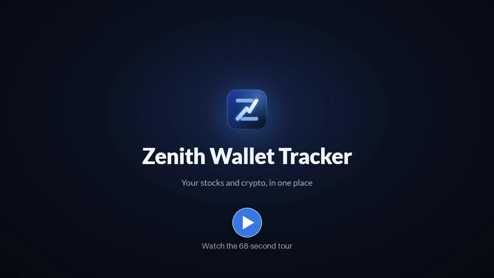
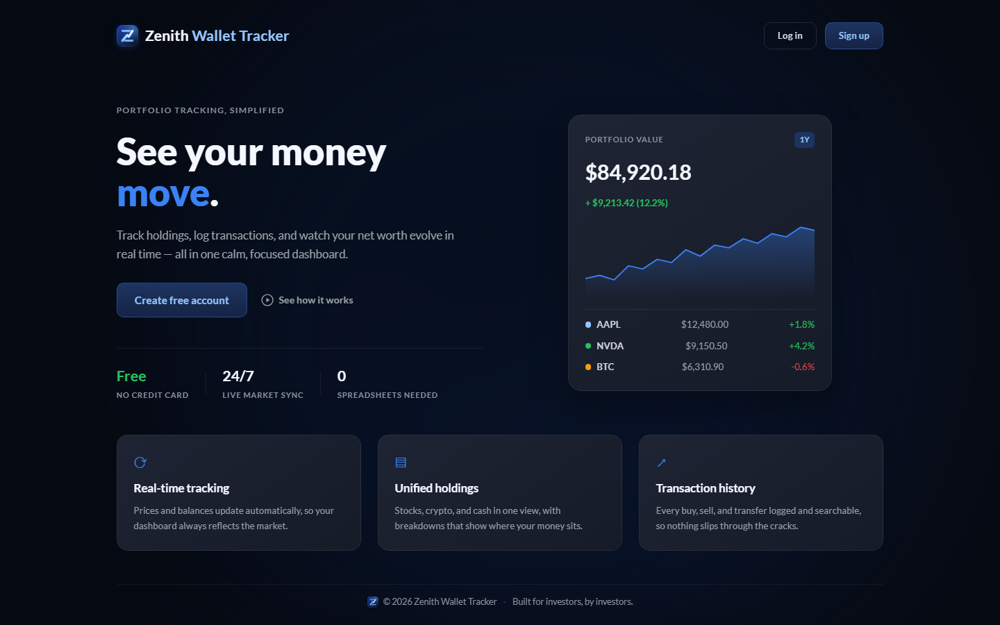
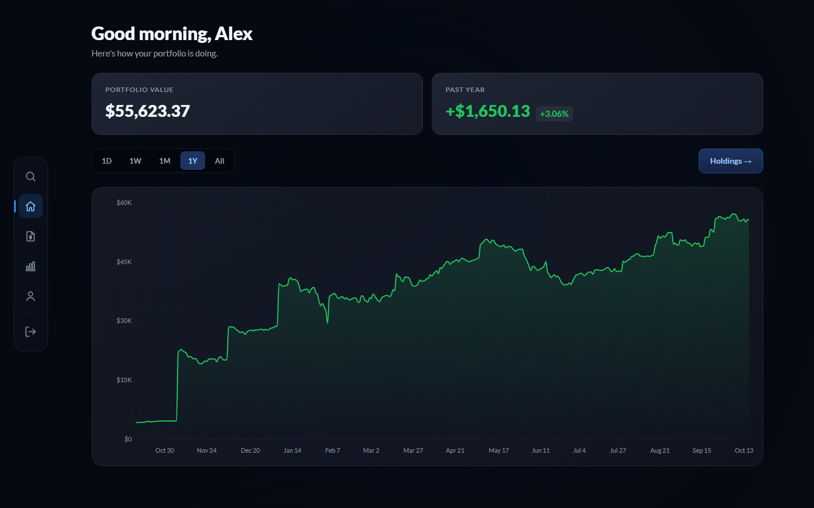
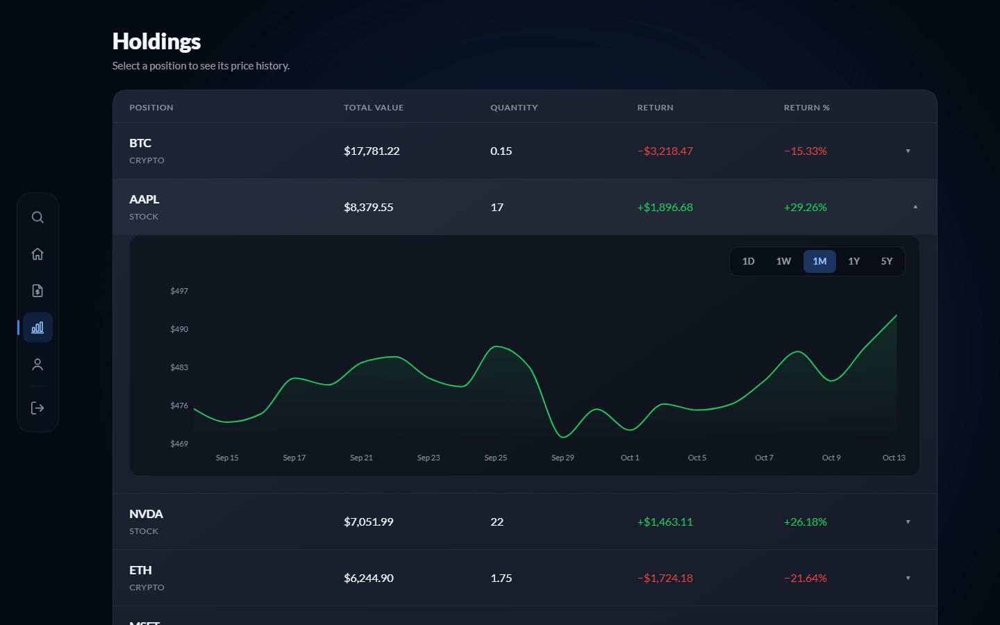
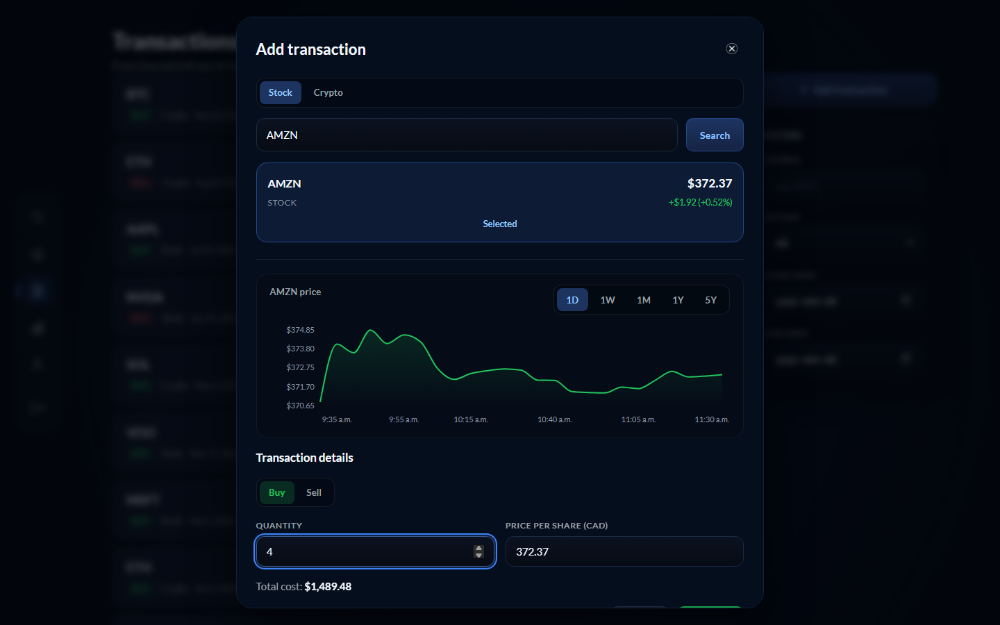
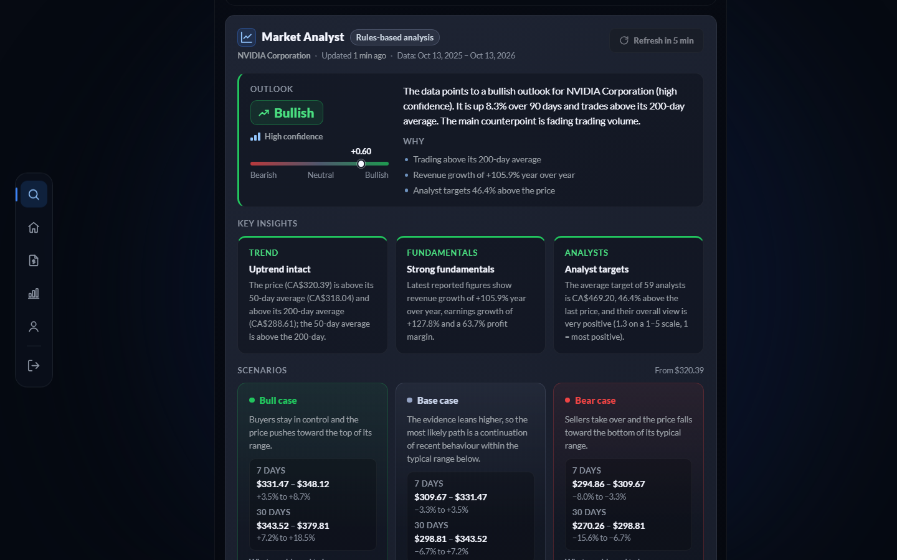
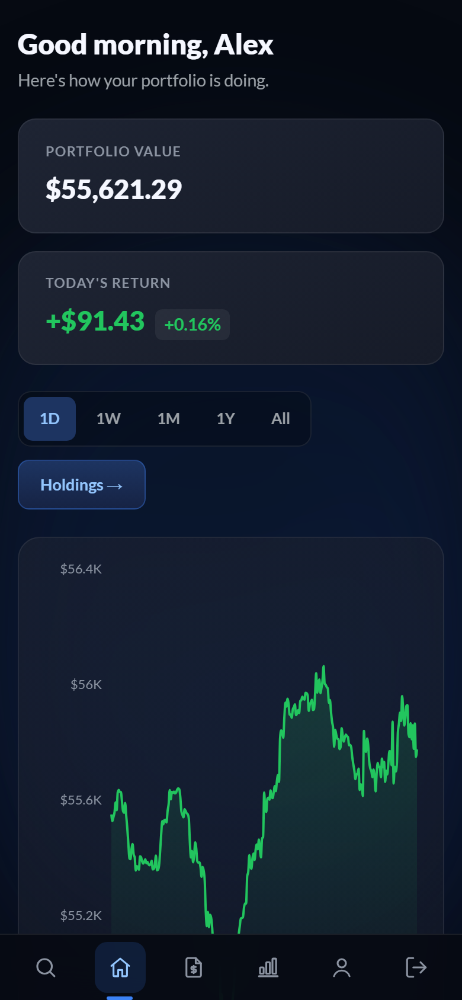
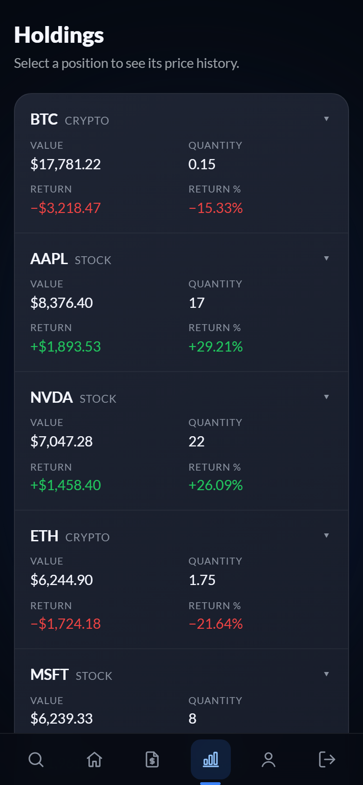
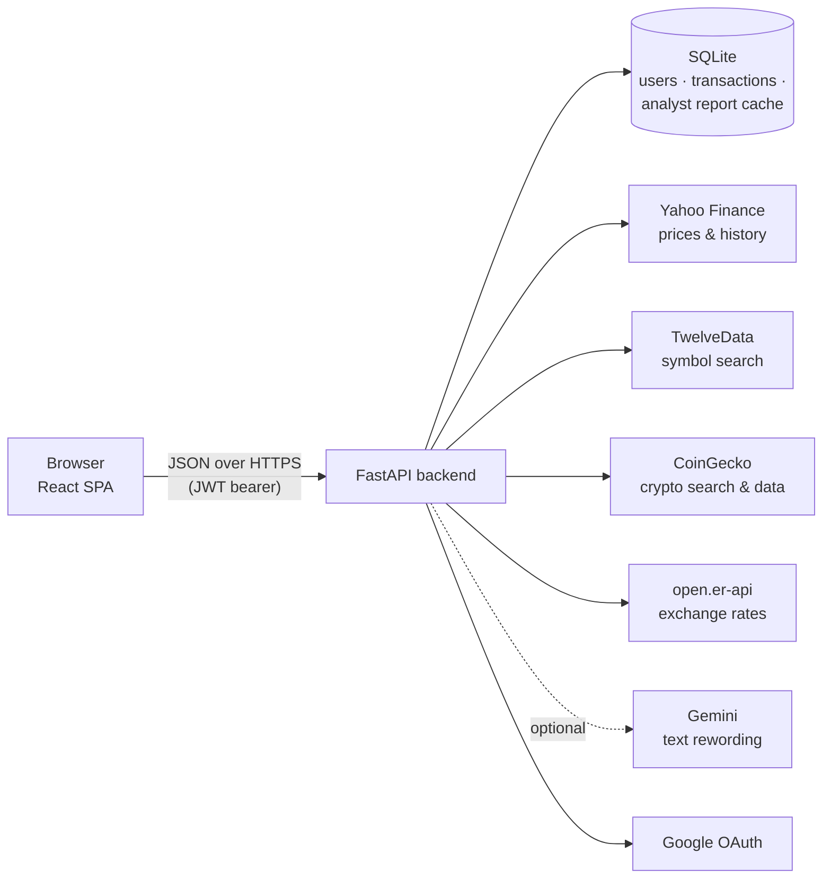

<div align="center">


# Zenith Wallet Tracker

[](https://github.com/S-vani/Zenith-Wallet_tracker/actions/workflows/ci.yml)

**Track your stocks and crypto in one place: log trades, follow your portfolio's value over time, and get a
rules-based market outlook for any symbol.**

[Live site](https://zenithwalletracker.ca) · [Watch the demo](https://zenithwalletracker.ca/demo/zenith-demo.mp4) ·
[Getting started](#getting-started) · [How it works](#how-it-works)

</div>

---

## Demo

<a href="https://zenithwalletracker.ca/demo/zenith-demo.mp4">
  
</a>

A 68-second walkthrough of the app: signing in, the dashboard, holdings, logging a buy, symbol search with the
Market Analyst, crypto search and switching currency. The same video plays from **See how it works** on the
landing page. It was recorded on a demo account with sample data, and the background music is original.

## Table of contents

- [Overview](#overview)
- [Features](#features)
- [Screenshots](#screenshots)
- [Tech stack](#tech-stack)
- [Architecture](#architecture)
- [Getting started](#getting-started)
- [Configuration](#configuration)
- [Running tests](#running-tests)
- [How it works](#how-it-works)
- [Project structure](#project-structure)
- [Deployment](#deployment)
- [Disclaimer](#disclaimer)

## Overview

Zenith Wallet Tracker is a full-stack web application for individual investors who hold both stocks and
cryptocurrency. Users record their buy and sell transactions, and Zenith calculates current holdings, realized and
unrealized returns, and the portfolio's value over any time range, priced in Canadian dollars, US dollars or euros.
Prices come from free market-data sources and are refreshed when you open a page, so they can lag the market a
little.

A built-in **Market Analyst** summarises any stock or coin with an outlook, key insights and bull, base and bear
price ranges. It is a transparent rules engine, not a paid AI service, so it is free to run and every sentence it
writes can be traced back to a number.

## Features

| | |
|---|---|
| **Portfolio dashboard** | Total value, the return for each range, and a value chart for 1D / 1W / 1M / 1Y / All. |
| **Holdings** | Every open position with its value, quantity and return, each with its own price chart. |
| **Transactions** | Log buys and sells with live symbol search and a pre-filled market price; filter by symbol, action and date; edit or delete past trades and the history stays consistent. |
| **Search** | Recent prices for US stocks, ETFs and thousands of cryptocurrencies, with company and coin names and interactive charts. Prices are fetched when you open a page and can be delayed. |
| **Market Analyst** | Bullish / neutral / bearish outlook with a confidence level, key insights, volatility-based scenarios, what to watch and the main risk. Informational only, not financial advice. |
| **Multi-currency** | View everything in CAD, USD or EUR; stocks listed in other currencies are converted automatically. |
| **Accounts** | Email sign-up with verification, or one-click Google sign-in. |
| **Responsive** | Works on desktop and phones, with a bottom tab bar on small screens. |

## Screenshots

| Landing page | Dashboard |
|---|---|
|  |  |
| **Holdings** | **Adding a transaction** |
|  |  |

**Market Analyst**



**On a phone**

<p>
  
  &nbsp;&nbsp;
  
</p>

## Tech stack

| Layer | Technology |
|---|---|
| Frontend | React 19, Vite, React Router, Recharts, plain CSS with design tokens |
| Backend | Python 3.11+, FastAPI, Uvicorn |
| Data | SQLAlchemy 2 (async) with SQLite via aiosqlite |
| Authentication | fastapi-users (JWT bearer tokens, email verification), Google OAuth 2.0 |
| Market data | Yahoo Finance (yfinance), TwelveData (stock symbol search), CoinGecko (crypto), open.er-api (exchange rates) |
| Optional AI | Google Gemini (free tier), used only to reword Market Analyst text |
| Testing | pytest (backend, fully offline), Vitest (frontend utilities) |
| Hosting | Linux server, nginx for the static frontend, the FastAPI service behind it |

## Architecture



All browser requests go through a single client module (`frontend/src/services/api.js`), which attaches the token
and turns errors into readable messages. The backend keeps API keys server-side and caches exchange rates, symbol
searches and analyst reports so it stays within the free tiers of each data provider.

## Getting started

### Prerequisites

- Python 3.11 or newer
- Node.js 20.19+ or 22.12+ (required by Vite 8)
- Optional: [uv](https://docs.astral.sh/uv/) for faster Python installs

### Installation

```bash
git clone https://github.com/S-vani/Zenith-Wallet_tracker.git
cd Zenith-Wallet_tracker

# Python packages
python -m venv .venv
.venv/bin/pip install -r requirements.txt          # Windows: .venv\Scripts\pip install -r requirements.txt
# or, with uv:  uv sync

# Frontend packages
npm --prefix frontend install
```

Create a `.env` file in the project root (see [Configuration](#configuration)) and `frontend/.env` containing
`VITE_BACKEND_URL=http://localhost:8000`.

### Running locally

```bash
npm run dev
```

This starts the backend on <http://localhost:8000> and the frontend on <http://localhost:5173>.
`npm run dev:backend` and `npm run dev:frontend` start just one of them, and `python backend/main.py` also runs the
backend on its own.

> **Windows:** if PowerShell reports that *npm.ps1 cannot be loaded*, run
> `Set-ExecutionPolicy -Scope CurrentUser RemoteSigned` once, or use `npm.cmd run dev`.

## Configuration

The backend reads `.env` from the project root. Never commit this file.

| Variable | Required | Purpose |
|---|---|---|
| `SECRET` | Yes | Signing key for JWTs and verification tokens. |
| `DATABASE_URL` | No | Defaults to `sqlite+aiosqlite:///./walletdatabase.db` in the project root. |
| `FRONTEND_URL` | Yes | Allowed CORS origin(s), comma-separated; also used in verification links. |
| `BACKEND_URL` | For Google | Public URL of the API, used for the Google callback. |
| `API_KEY` | Yes | TwelveData key (stock symbol search; the free plan allows 8 requests per minute). |
| `API_KEY_COINEGECKO` | Yes | CoinGecko demo key. |
| `GMAIL_USER`, `GMAIL_PASS` | No | Gmail address and app password for verification emails. If empty, the link is printed in the backend log. |
| `GOOGLE_CLIENT_ID`, `GOOGLE_CLIENT_SECRET` | No | Enables "Continue with Google". The button is hidden without them. |
| `GEMINI_API_KEY`, `GEMINI_MODEL` | No | Optional free Gemini key for Market Analyst rewording (model defaults to `gemini-2.5-flash`). |

<details>
<summary><strong>Setting up Google sign-in</strong></summary>

1. In the [Google Cloud console](https://console.cloud.google.com/), create (or pick) a project.
2. **APIs & Services → OAuth consent screen**: set it up as External, with the app name, support email and the
   `email`, `profile` and `openid` scopes.
3. **APIs & Services → Library**: enable the **Google People API**, which is used to read the account's email and name.
4. **APIs & Services → Credentials → Create credentials → OAuth client ID**, type **Web application**, with these
   authorized redirect URIs:
   - `https://your-backend-domain/auth/google/callback`
   - `http://localhost:8000/auth/google/callback` (local development)
5. Copy the client ID and secret into `.env` and restart the backend.

Signing in with Google creates a verified account, or links to an existing account with the same email, so no
verification email is needed.

</details>

## Running tests

```bash
uv sync                      # or: pip install -r requirements-dev.txt  (test dependencies)
npm test                     # backend (pytest) then frontend (Vitest)
```

- `npm run test:backend` runs the pytest suite in `tests/`. Pass extra arguments after `--`, for example
  `npm run test:backend -- -k dashboard`.
- `npm run test:frontend` runs the Vitest suite in `frontend/test/`. `npm --prefix frontend run test:watch` re-runs
  it on save.
- The backend tests are fully offline: they use a throwaway SQLite database and a test secret, block all network
  access, and fake every market-data provider. They never touch your `.env` values, your database or a real API.
- Linting and production build: `npx eslint .` and `npx vite build` in `frontend/`.

## How it works

### Prices and currencies

Transactions are stored in Canadian dollars as fixed-point decimals (`Numeric(20, 10)`) with UTC timestamps, and
converted to the user's currency only when they are returned. Stock prices arrive in the currency they are listed
in (for example USD, EUR, or pence for London listings). They are converted to CAD with cached cross rates, and
rows with missing prices are skipped.

### Portfolio history

Zenith stores no daily snapshots. The transaction log is the single source of truth. For each point on a chart, the
backend replays the transactions up to that moment to find what was held, then values those holdings with
historical prices. Editing or deleting a past trade therefore corrects the whole history automatically, and a
ledger check rejects any edit that would sell more than was owned.

### Market Analyst

1. **Data:** about a year of daily prices and volume, plus company fundamentals and analyst targets for stocks, or
   market data and Bitcoin's history for crypto.
2. **Indicators:** 50- and 200-day moving averages, 30- and 90-day returns, 14-day RSI, volume trend, annualized
   volatility from log returns, and correlation with Bitcoin. These are pure, unit-tested functions.
3. **Scoring:** each signal is scored from −1 to +1 and weighted. A weighted average above +0.15 is bullish, below
   −0.15 is bearish, and anything in between is neutral. Confidence reflects how much data there is and how many of
   the signals agree; a split trend or a strong counter-signal keeps it at medium or below.
4. **Scenarios:** 7- and 30-day price ranges use a zero-drift log-normal model of recent volatility. They describe
   how far the price typically moves and are not predictions.
5. **Text:** sentences are built only from numbers that also appear in the report's metrics. If a Gemini key is
   set, the text may be reworded, and a validator rejects any rewrite that introduces new numbers or changes the
   meaning.
6. **Serving:** reports are cached for 1 hour for stocks and 30 minutes for crypto, and fresh reports are
   rate-limited per user.

## Project structure

```
├── backend/
│   ├── main.py               # FastAPI app, CORS, error handlers
│   ├── routes/               # assets (transactions, holdings, search, history), oauth, analyst
│   ├── services/             # pricing, currency conversion, holdings and ledger maths
│   ├── analyst/              # data collection, indicators, rules engine, Gemini rewording, caching
│   ├── authentication/       # fastapi-users setup (JWT strategy, current-user dependency)
│   ├── db/                   # async engine and session
│   ├── db_models/            # User, Transaction, OAuthAccount, user manager
│   └── schemas/              # request / response models
├── frontend/
│   ├── public/               # favicon, logo, demo video
│   └── src/
│       ├── pages/            # one component per route
│       ├── Dashboard/ Holdings/ Transactions/ Search/ Analyst/ Authentication/ Home/
│       ├── services/api.js   # the only module that calls the backend
│       ├── utils/            # formatting, charts, toasts
│       └── css/              # styles, with design tokens in Global.css
├── tests/                    # pytest suite (offline)
├── docs/screenshots/         # images used in this README
└── scripts/                  # dev and test runners used by package.json
```

## Deployment

The production server runs the code from a Git checkout:

```bash
git pull
uv sync                                   # or: .venv/bin/pip install -r requirements.txt
cd frontend && npm ci && npm run build    # copy dist/ to the nginx web root if it serves /var/www/html
sudo systemctl restart walletapp-backend   # required: a pull alone does not reload the Python process
```

Check that the API is up with `curl https://api.zenithwalletracker.ca/auth/providers`.

## Disclaimer

Zenith is a personal portfolio tracking tool. The Market Analyst is an automated, rules-based summary of publicly
available data. It is not financial advice and does not recommend buying or selling any security.
